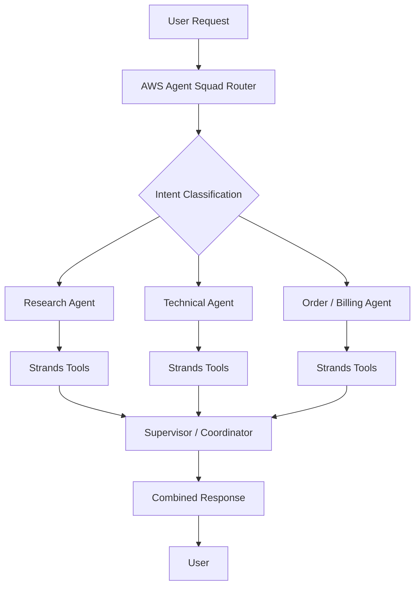

# Diagram 2 – Multi-Agent Workflow with Strands and Agent Squad

This diagram shows how Agent Squad can route work to specialized agents and how a supervisor can combine results when several agents are needed.
