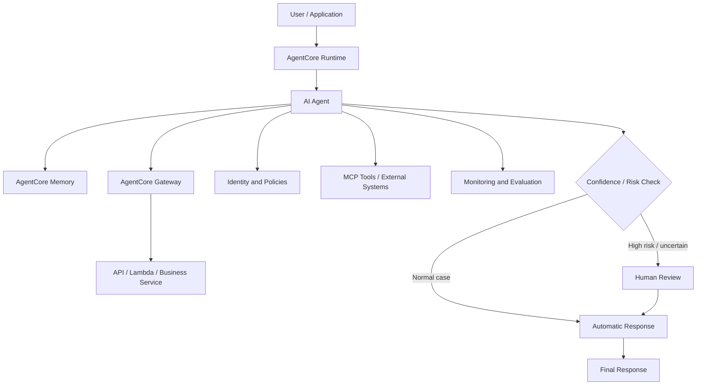

# Diagram 3 – AgentCore Deployment Architecture

This diagram shows the main parts needed to run an AI agent safely in a real application, including memory, tools, security, monitoring, MCP, and human review.
